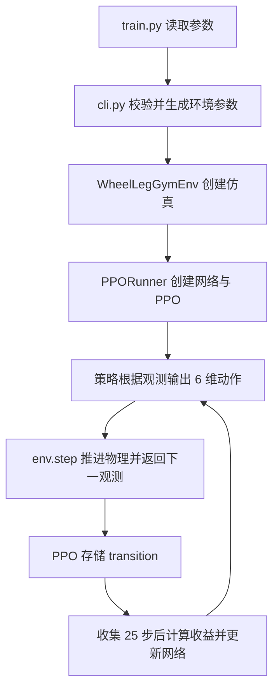

# 中文代码导读

本页解释代码如何连接。默认值以 [config.py](../wheelleg_gym/config.py) 为准，
实验进展见 [EXPERIMENTS.md](EXPERIMENTS.md)。

## 1. 阅读顺序

| 顺序 | 文件 / 位置 | 重点 |
| --- | --- | --- |
| 1 | [config.py](../wheelleg_gym/config.py) | 动作顺序与单位、物理默认值、观测维度、网络/PPO 参数 |
| 2 | [train.py](../train.py) | 参数怎样变成环境和训练器 |
| 2a | [runtime_config.py](../wheelleg_gym/runtime_config.py) | 检查点、稳定性预设与显式参数的优先级 |
| 3 | [env.py](../wheelleg_gym/env.py) 的 `__init__()`、`step()` | 创建仿真，一次控制步的完整时序 |
| 4 | `env.py` 的 `_kinematics()`、`_observations()`、`_rewards()` | 策略看到什么、优化什么 |
| 5 | [kinematics.py](../wheelleg_gym/kinematics.py) | 五连杆几何、对称机构逆解 |
| 6 | [constraints.py](../wheelleg_gym/constraints.py) | 树形 URDF 如何通过外力近似闭合 |
| 7 | [training.py](../wheelleg_gym/training.py) | 收集 rollout、PPO 更新、权重保存 |
| 8 | [play.py](../play.py)、[evaluate.py](../evaluate.py) | 策略推理、键盘输入与评估 |
| 抬轮 | [WHEEL_LIFT.md](WHEEL_LIFT.md)、[lift.py](../lift.py)、[wheel_lift.py](../wheelleg_gym/wheel_lift.py) | 先站稳、预倾换重心、短暂收腿、落轮恢复；现有 RL + 显式控制 |
| 阶梯 | [STAIRS.md](STAIRS.md)、[terrain.py](../wheelleg_gym/terrain.py)、[stair_rewards.py](../wheelleg_gym/stair_rewards.py) | 五档地形、252维输入、髋角动作与完整课程判据 |

先看本项目的封装，再按需要深入 `third_party/rsl_rl/`，其中保留了原组件和许可证。

## 2. 从入口到策略



训练、播放和评估使用同一个环境。训练时从策略分布采样动作；播放与评估使用确定性推理。
键盘设置的是策略的目标速度，不直接给轮子施力矩。

`step()` 返回五项：

```python
observations, privileged_observations, rewards, dones, infos
```

本环境没有额外特权观测，第二项为 `None`。终止后会自动重置对应机器人，
`infos` 保留终止前的观测和诊断，评估需要使用这些值，避免把重置后的直立姿态计作终止姿态。

## 3. 机器人与闭合连接

模型数据见 [资产说明](../assets/wheelleg/README.md)：

- `urdf/Robot_Model.urdf`：11 个刚体、10 个树关节、质量与惯量。
- `meshes/`：视觉/碰撞网格。
- `loop_constraints.json`：树结构外的两个闭合铰链、局部锚点与轴方向。
- `export_report.json`：从 USD 转换后的几何校验。

`env.py::_load_robot()` 设置主动关节为力矩控制，被动关节不继承位置 PD 驱动。
`ClosureForces` 根据刚体状态计算闭合点位置、点速度和铰链轴误差，返回成对力与绕质心的力矩。

连杆本身是刚体，闭合连接具有有限刚度。恢复力为 `stiffness × gap + damping × relative_velocity`，
幅值默认限制在 500 N。轴对齐力矩保留绕共同铰链轴的自由转动。
这不等于原生刚性闭环关节，训练奖励不能替代闭合误差检查。

坐标约定：默认 X 前、Y 左、Z 上；Gym 四元数顺序为 **XYZW**。
刚体位置参考连杆原点，线速度参考质心；施加外力时的力臂从质心量到锚点。

## 4. 一个控制步的时序

按以下顺序阅读 `env.py::step()`：

1. 接收并检查 `[num_envs, 6]` 动作。
2. 按控制模式转换动作：旧模式缩放为力矩；阶梯模式先生成髋目标角，再由PD和前馈计算力矩，最终裁剪。
3. 每个物理步重新计算闭环外力、施加关节力矩、推进 PhysX、刷新刚体状态。
4. 刷新根状态与关节状态，计算腿长、姿态、机体速度与连续航向。
5. 构造动作后的观测，用本次动作对应的指令计算奖励与终止条件。
6. 保存终止前诊断，更新上一动作，自动重置终止机器人。
7. 可选地为下一次推理重采样并平滑随机指令，只刷新最新指令字段。
8. 有窗口时绘制画面，返回下一观测。

默认每次动作保持 0.02 秒，物理步长 0.0005 秒，第 3 步循环 40 次。
画面墙钟速度可以慢于仿真时间，奖励和航向积分仍按仿真控制周期计算。

## 5. 六维动作

以下系数对应旧力矩模式：

| 下标 | 关节 | 动作到力矩的系数 |
| --- | --- | --- |
| 0 | `L_F_Joint1` 左前髋 | 0.5 Nm / 动作单位 |
| 1 | `L_H_Joint1` 左后髋 | 0.5 |
| 2 | `R_F_Joint1` 右前髋 | 0.5 |
| 3 | `R_H_Joint1` 右后髋 | 0.5 |
| 4 | `L_lun_Joint` 左轮 | 10.0 |
| 5 | `R_lun_Joint` 右轮 | 10.0 |

转换后所有主动关节裁剪到 ±9 Nm。网络输出、探索噪声和实际力矩是不同概念。
顺序由 `config.py::ACTION_JOINTS` 定义；右腿几何的前后角映射在 `_kinematics()` 中处理。

阶梯使用`leg_control=hip_target`：前四维为`clamp(action, -1, 1) × 0.2 rad`的髋目标角增量，叠加在腿长逆解角上并裁剪到真实关节限位；
后两维保持轮子力矩含义。髋PD为80/4，另加每腿22.4649 N近似支撑前馈，最终仍限±9 Nm。
对应实现见[leg_control.py](../wheelleg_gym/leg_control.py)与`env.py::step()`。相同六维输出不代表不同控制模式下的动作语义相同。

平地`stand.sh`另外选择`wheel_control=heading`，实现位于[wheel_control.py](../wheelleg_gym/wheel_control.py)：

- 此模型轮轴镜像，轮子力矩`[-drive, +drive]`用于前后平衡，`[steer, steer]`用于转向。
- 保留策略轮子力矩的差模`drive=(右−左)/2`，由显式航向/偏航角速度反馈取代策略共模；当前脚本增益6/0.6。
- `drive`先限到±9 Nm；`steer`限制在±1 Nm内，同时不超过`9−abs(drive)`的执行器余量。
- 内部航向参考每步积分目标偏航速度，并将其相对实际航向的误差限制在±0.35 rad，减少饱和后的参考积压；实际转角不受此限制。

`wheel_control=policy`保留原行为，仍是直接调用入口的默认值。此次`stand.sh`修正只改控制处理，没有重训权重，静止俯仰尚未改善。

## 6. 指令与观测

指令顺序为 `[vx, vy, yaw_rate, leg_length]`，单位为 m/s、m/s、rad/s、m。
腿长指令允许0.06–0.20 m，默认随机训练范围仍保留0.06–0.15 m。随机训练采样前后速度、偏航速度和腿长，横向速度保持零。

每帧旧布局为 31 维，以下区间采用 Python 左闭右开写法：

| 区间 | 内容 | 缩放 |
| --- | --- | --- |
| `0:3` | 机体坐标系线速度 | × 1.5 |
| `3:6` | 机体坐标系角速度 | × 0.5 |
| `6:9` | 机体坐标系单位重力方向 | 无 |
| `9:13` | 当前四维指令 | × `[1.5, 0.5, 1, 5]` |
| `13:17` | 四个主动髋角相对当前腿长对称逆解的偏差 | 无 |
| `17:23` | 六个主动关节角速度 | × 0.05 |
| `23:29` | 刚刚执行的六维原始动作 | 无 |
| `29` | 实际前后速度减目标速度 | × 1.5 |
| `30` | 连续航向减累计目标航向 | 无 |
| `31:33`（可选） | 左右实际腿长 | × 5 |
| `33:42`（阶梯，已开启腿长输入） | 前方9点高度减双轮下地面高度均值 | 裁剪到±0.5 m后×5 |

五帧历史加当前帧得到 `31 × 6 = 186` 维。开启 `--observe-leg-lengths`
后每帧为 33 维，共 198 维。旧布局的对称角偏差不直接表达绝对腿长，这是新增腿长输入的原因。
阶梯再加入9个地形点，每帧42维，六帧共252维；采样点与网格高度查询在`terrain.py::StairTerrain`。

`_observations()` 才推进历史；`set_commands()` 只改当前指令和最新帧，不额外推进物理或历史。
默认 186 维用于兼容现有权重。

## 7. 奖励与终止

基础奖励在 `env.py::_rewards()`，包含线速度、偏航速度、腿长、姿态、航向、
对称性、动作幅度和动作变化等项，保留在环境中便于对照源任务。

[rewards.py](../wheelleg_gym/rewards.py) 提供可选补充：

| 开关 | 行为 |
| --- | --- |
| `--tracking-penalties` | 连续的平面速度与腿长误差惩罚 |
| `--stability-rewards` | 倾角、横滚/俯仰角速度、实际力矩变化惩罚；替换旧原始动作变化项，环境另加连续偏航误差项 |

稳定奖励按裁剪后的 Nm 力矩比较腿与轮子，不把相同原始动作变化当作相同力矩变化。
代码支持某个开关，不表示已有权重已接受对应训练。

平地俯仰/横滚绝对值超过0.35 rad、几何无效、状态非有限或闭合误差超过30 mm时物理终止。
平地默认时间上限16秒；`time_outs`只标记正常超时，物理失败不按正常超时处理。
键盘模式取消周期性超时重置，评估可用 `--disable-time-limit` 检查连续运行。

阶梯使用独立的`stair_rewards.py`，鼓励有符号前进、速度跟踪、姿态稳定和真正到达终点，包含失败与通过奖励。
进度与速度跟踪使用双轮中心的世界X位移和世界XY速度，避免双轮卡住时靠机身前倾刷进度；地形扫描也改用轮下地面均值作为参考。
不再强制保持左右腿对称或某个精确腿长。阶梯俯仰阈值0.65 rad，横滚仍为0.35 rad，另检查通道出界、停滞与机身碰撞，默认24秒回合。
真实通过才升档；早期失败降档但受最低档限制。高奖励、少重置与真正通过课程是不同指标，详见[阶梯说明](STAIRS.md#用完整课程评估)。
当前默认演示在修正后的代码中通过1 cm课程的4环境、26秒复测；这不代表2 cm及更高阶梯已经通过，报告与训练进度见[阶梯说明](STAIRS.md)。

## 8. PPO 与实验文件

`training.py::PPORunner` 适配环境与旧 RSL-RL：

```text
act → env.step → process_env_step → 重复收集 → compute_returns → update → save
```

网络、rollout 长度和优化轮次等参数在 `config.py::TRAIN_CONFIG`。
PPO 算法位于 `third_party/rsl_rl/algorithms/ppo.py`，缓冲位于 `storage/rollout_storage.py`。

| 实验目录中的文件 | 含义 |
| --- | --- |
| `config.json` | 网络/PPO 和环境参数 |
| `launch.json` | 起始轮次、新增轮数、并行数量 |
| `progress.json` | 最近完成的一轮统计，含 `Motion/` 姿态、力矩和跟踪诊断 |
| `training_summary.json` | 本次运行已经完成的各轮统计 |
| `model_N.pt` | 策略、优化器、完成轮次、环境配置 |
| `events.out.tfevents.*` | TensorBoard 曲线 |

`--max-iterations` 是新增轮数。并行数量改变会改变每轮样本量，轮次不等于训练样本量。

## 9. 键盘与评估

`keyboard.py` 维护按住/松开状态，`play.py` 把目标经过可选 `CommandGovernor` 后传给环境。
`commands.py` 的加速度限制使用仿真时间，训练与推理应保持相同设置。
`stand.sh`显式设置前后0.6 m/s、自旋2 rad/s与4 rad/s²偏航加速度；Q/E以0.02 m/s调整6～20 cm有效腿长。
`KeyboardDrive.advance_leg_length(env.dt)`每控制周期调用一次，`command()`只读取；空格停止腿长变化，R恢复初始腿长目标。

单机器人播放使用`--physics-threads 0`，减少PhysX线程调度；窗口分辨率通过`--viewer-width/--viewer-height`设置。
`constraints.py`把同一刚体的三个常量向量一起旋转，`errors()`只计算闭合点位置，不重复计算轴线和速度。
这些优化没有改物理步长、力矩限幅、闭环刚度、PD或策略频率。CPU批量训练仍可选更多线程。

`evaluate.py` 负责运行、采集终止前状态和写报告。
[evaluation_metrics.py](../wheelleg_gym/evaluation_metrics.py) 负责速度分组、指令序列和统计。
报告分别给出原始目标与限速后目标的误差，避免平滑掩盖跟踪问题。
`playback_log.py` 可记录指令变化、手动重置、物理失败，格式为 JSONL。

[evaluate_drive_stability.py](../tools/evaluate_drive_stability.py)固定28秒静止、前后、启停与左右转向序列。
它从终止前四元数展开真实航向，独立积分未受±0.35 rad限制的要求角，避免内部参考限幅掩盖转向跟随不足；位移排除重置瞬移，失败完整保留。
前/倒偏航RMS实测10.78°→0.149°、4.25°→0.087°，两组均无物理失败；详细工况见[驾驶复测](USAGE.md#平地驾驶复测)。

训练与推理通过 `runtime_config.py` 恢复相应的检查点参数；预设和显式参数可覆盖。
推理不继承随机训练模式、设备或并行数量。网络输入尺寸会在创建环境前检查。
仍应核对检查点的 `environment_config` 和最终解析配置，不能把修改预设当成旧策略已经接受了新训练。
具体优化及复测流程见 [训练优化](TRAINING_OPTIMIZATION.md)。

## 10. 想改什么，去哪里

| 目标 | 首先查看 |
| --- | --- |
| 网络或 PPO | `config.py::TRAIN_CONFIG` |
| 默认步长、动作缩放、关节顺序 | `config.py`，以及 `env.py` 中的使用位置 |
| 闭合连接 | `constraints.py`、`loop_constraints.json` |
| 杆长与几何 | `kinematics.py`，同时核对 URDF/网格 |
| 观测 | `env.py::_observations()`、`observation_upgrade.py`、网络输入维度 |
| 奖励 | `env.py::_rewards()`、`rewards.py`；阶梯为`stair_rewards.py` |
| 阶梯网格与地形采样 | `terrain.py::StairTerrain`、`env.py::_observations()` |
| 阶梯课程、成功与终止判据 | `env.py::_stair_diagnostics()`、`step()`；`training.py`保存课程状态 |
| 阶梯权重准备与完整课程复测 | `tools/prepare_stair_checkpoint.py`、`tools/evaluate_stairs.py` |
| 起停与换向指令 | `commands.py`、`env.py::_advance_random_commands()` |
| 按键 | `keyboard.py`；WASD 保留给原生相机 |
| 轮子差模平衡、航向与力矩余量 | `wheel_control.py`、`env.py::step()` |
| 平地偏航与启停晃动对比 | `tools/evaluate_drive_stability.py`，以及报告的逐阶段RMS/标准差/实际距离 |
| 晃动与终止原因 | `playback_log.py`、评估中的运动统计、训练 `Motion/` 指标 |

修改后按 [测试方法](USAGE.md#测试) 验证。代码测试通过只覆盖相应实现与接口，
控制稳定性仍需持续运行和人工操作检验。
